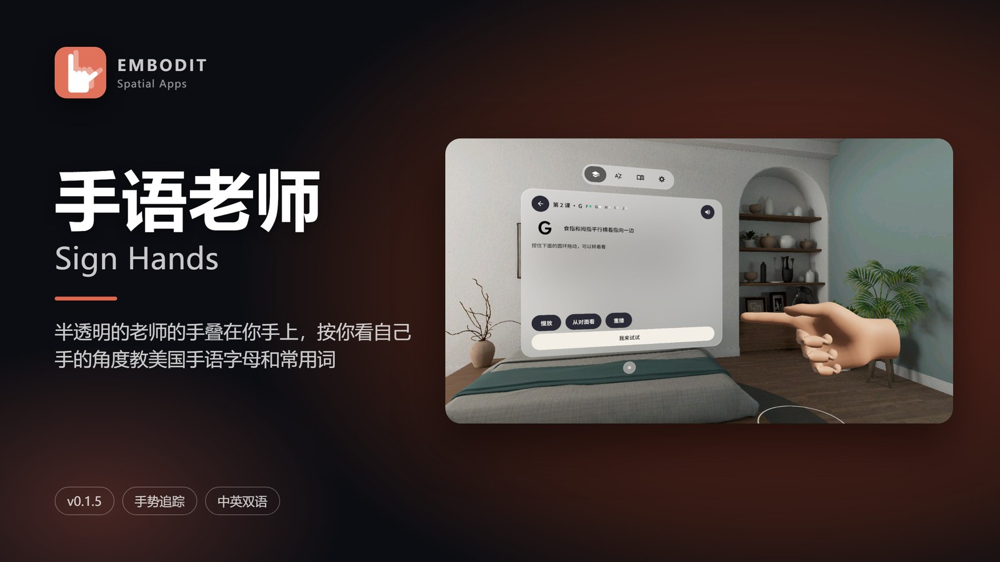
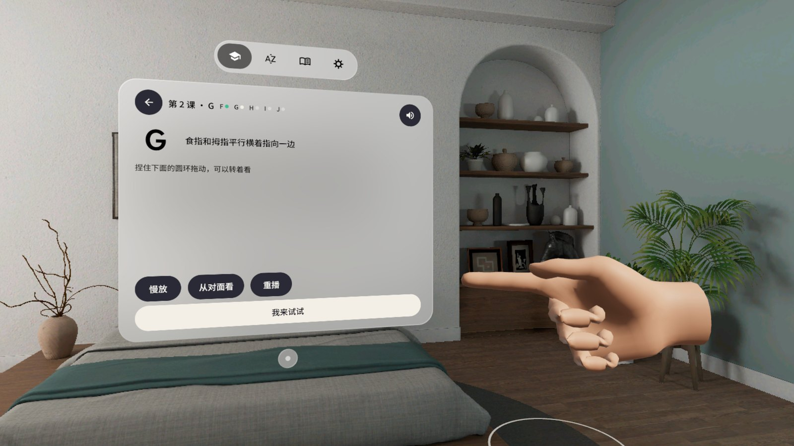
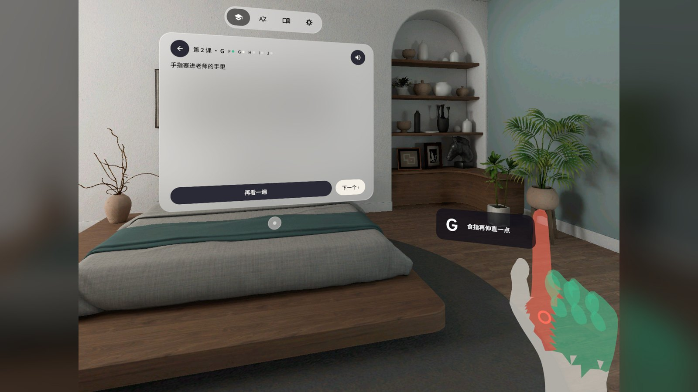
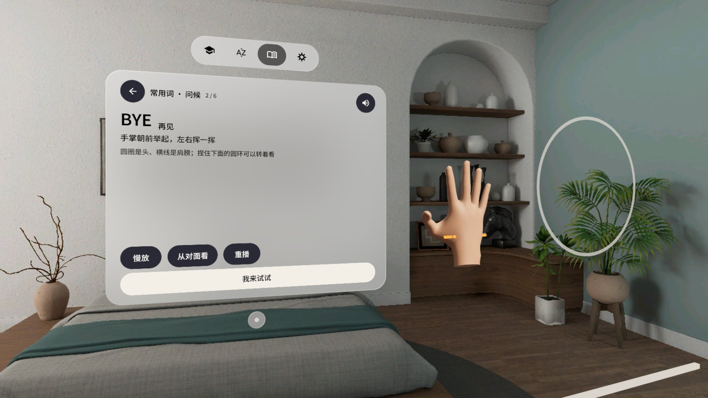
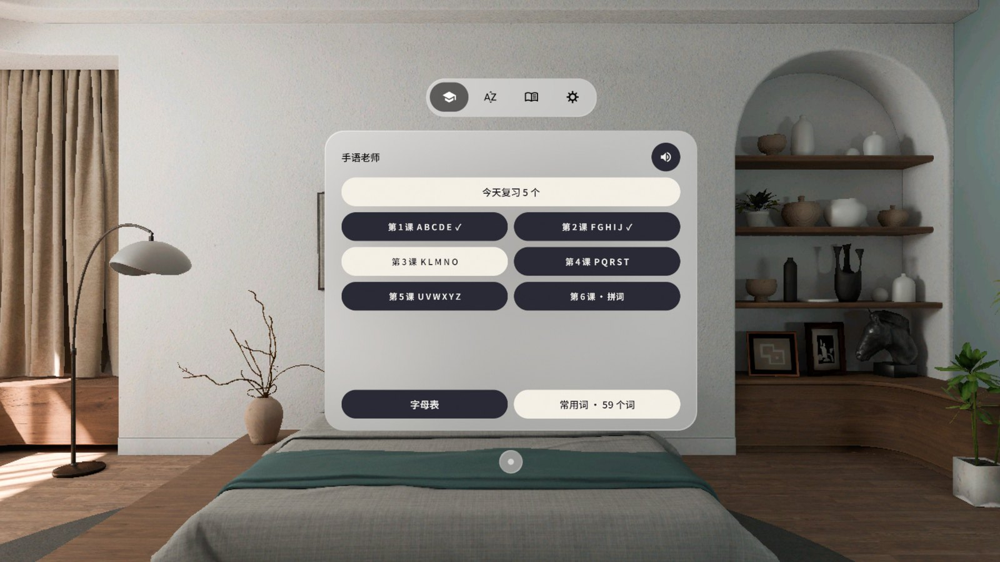
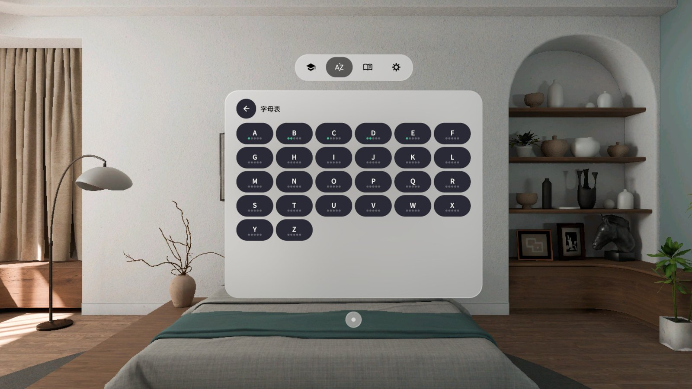
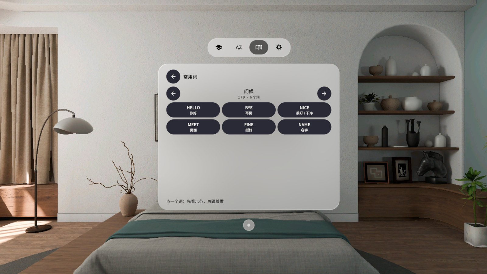

# 手语老师 Sign Hands



**中文** · [English](#english)

一双半透明的「老师的手」叠在你自己的手上，按你看自己手的角度（第一人称、不镜像）教美国手语（ASL）26 个字母和 59 个常用词。PICO 头显，PICO Spatial SDK 6.1。

## 怎么学

- **看示范**：眼前放大的写实手模从张开变成字母，可以慢放、捏住下面的圆环转着看，一键「从对面看」。
- **跟做**：老师的手按你的手长叠在你手上。哪根手指不对，那根标成珊瑚色，手腕旁的标签写一行提示（「食指再伸直一点」）。摆对了自动下一个。
- **小测和复习**：一课学完做小测，学过的字母按 1 / 3 / 7 / 14 / 30 天回来复习。
- 判定是宽松的：相近手形只比关键差别，J / Z 看轨迹形状，连着几次不对会自动放宽并告诉你差在哪。

| | |
|---|---|
|  看示范：老师的手打出 G |  跟做：食指没伸直，标签提示 |
|  常用词：BYE 再见 |  主页 + 原生 TabBar |
|  字母表与掌握程度 |  59 个常用词，9 个主题 |

> 截图和演示视频在 PICO 模拟器上用调试广播驱动（合成的手），**不是真实手势录像**。

## 安装

从 [Release v0.1.5](https://github.com/kejing-dev/SignHands/releases/tag/v0.1.5) 下载 `SignHands-v0.1.5.apk`：

```bash
adb install -r SignHands-v0.1.5.apk
pico-cli app launch io.embodit.signhands
```

调试构建（debug 签名）。装过别的电脑构建的版本时，签名不同，先 `adb uninstall io.embodit.signhands`（学习进度会清掉）。

## 版本

- **v0.1.5**：手边标签避开窗口下方的系统小圆点和上方的 TabBar（QA #3 q3-1）。
- **v0.1.4**：所有 2D 内容合进一个系统窗口，页签换成 SpatialUI 原生 TabBar，删掉自建 3D 拖动条；示范手换写实手模；设置里「叫回面前」。
- **v0.1.3**：判定放宽（M / N / J），常用词 59 个，设置里「退出应用」。
- **v0.1.0–v0.1.2**：26 个字母、6 课、间隔重复复习、中英双语。

## 已知情况

- 把窗口拖走以后，示范手和标签不会跟着让开；设置里点「叫回面前」重新对齐。
- 标签和窗口在真机上的实际间距还没量过。
- 这是美国手语 ASL 的手指字母，不是中国手语。

## 隐私

离线可用，没有网络权限、没有账号。手部关节数据只在内存里实时比对，不存盘；学习进度存在应用私有目录。

手模：WebXR Input Profiles generic-hand，MIT，Copyright (c) 2019 Amazon（`app/src/main/assets/licenses/`）。

---

## English

A pair of translucent "teacher's hands" sits right on top of your own hands, shaped from your own point of view (first person, not mirrored), and teaches the 26 letters of the American Sign Language (ASL) alphabet and 59 everyday words. For PICO headsets, PICO Spatial SDK 6.1.

- **Watch**: an enlarged, realistic hand forms the letter; slow motion, pinch the ring to turn it, or "view from the other side".
- **Follow**: the teacher's hand is scaled to your hand. The finger that is off turns coral and a label by your wrist says what to fix ("Straighten your index finger"). Get it right and the next letter starts by itself.
- **Quiz and review**: a short quiz after each lesson; learned letters come back after 1 / 3 / 7 / 14 / 30 days.
- Forgiving judging: similar handshapes are compared only on what tells them apart, J / Z are judged by the shape of the path, and repeated misses loosen the check and tell you what is off.

> Screenshots and the demo video were driven by debug broadcasts on the PICO emulator (a synthetic hand). **They are not recordings of real hand tracking.**

### Install

Download `SignHands-v0.1.5.apk` from [Release v0.1.5](https://github.com/kejing-dev/SignHands/releases/tag/v0.1.5):

```bash
adb install -r SignHands-v0.1.5.apk
pico-cli app launch io.embodit.signhands
```

Debug-signed build. If a build from another machine is installed, uninstall it first (`adb uninstall io.embodit.signhands`; progress is reset).

### Known issues

- After you drag the window away, the demo hand and the label do not move out of its way; use "Bring here" in Settings.
- The real-device distance between the label and the window has not been measured yet.
- This is ASL fingerspelling, not Chinese Sign Language.

Offline, no network permission, no account. Hand joints are compared in memory only and never stored.
Hand model: WebXR Input Profiles generic-hand, MIT, (c) 2019 Amazon.
